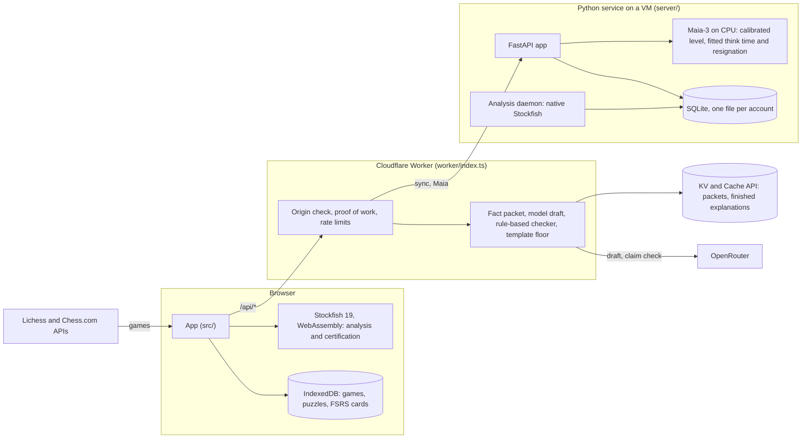

# lidrill

lidrill ([lidrill.org](https://lidrill.org)) is a personal mistake coach for chess: it turns your own Lichess and Chess.com games into a short daily drill, scheduled with spaced repetition so the positions you keep missing come back more often. Each mistake is explained with engine-checked text and board arrows, and you can spar against Maia-3, a model that plays like a person, at about your level.

<!-- DEMO GIF: about 15 seconds. Solve one puzzle on Train, tap "Why?", let the arrows and the text appear. -->
*Demo GIF to be added: one puzzle solved on Train, then "Why?" tapped.*

<!-- SCREENSHOT 1: the puzzle screen after "Why?", with the red, orange and green arrows on the board and the explanation under it. -->
*Screenshot to be added: the puzzle screen with the "Why?" arrows showing.*

<!-- SCREENSHOT 2: Openings, Spar, a few moves into a game against Maia-3. -->
*Screenshot to be added: opening sparring against Maia-3.*

## Compared with other trainers

| | Positions | Repetition | Explanation | Cost |
| --- | --- | --- | --- | --- |
| Lichess "Learn from your mistakes" | Your mistakes in one analysed game | None, it is per game | The engine's better move | Free |
| Chess.com Game Review | One reviewed game at a time | Retrying moves inside the review | Move classifications and coach text | Limited on free accounts |
| Chessable | Courses written by authors | Spaced repetition | The author's notes | Some free courses, most paid |
| lidrill | Your mistakes across all your games on both sites | Spaced repetition (FSRS) | Model text held to engine-certified facts, with arrows | Free, AGPL |

lidrill has no hand-written courses, so its explanations are short and tactical where a Chessable author teaches plans. Analysis runs in your browser and takes your device's time, and Maia runs on a single CPU-only VM.

## Features

- Train is the daily drill. A first visit opens on three sample puzzles, before any sign-in.
- Openings teaches the openings you pick against the replies Maia-3 gives at your rating, reviews them on the same schedule as the puzzles, and lets you spar an opening from move 1.
- Play Maia is a whole game against Maia-3 with a clock, and the mistakes you make in it become puzzles.
- Turning Points replays one of your games and stops where it turned, and the conversion and defense drills play out your own positions against Maia.
- The clocks of your games show where your time went.
- Everything is stored in the browser and works offline. A signed-in Lichess account syncs between devices.

## Architecture



[ARCHITECTURE.md](ARCHITECTURE.md) lists every endpoint, its checks and the configuration on each side.

## Explanations

The model never sees the board. Stockfish certifies the position in the browser at depth 24, the Worker turns the engine's lines into a list of facts with ids, and the model writes slots that may only point at those ids. A rule-based checker rejects a draft that names a move, pattern or mate outside the facts. A draft whose every word is either a plain word or appears in a fact cited in the same sentence is served after that one call, and any other draft goes to a second model that cuts unsupported claims. When a draft fails twice, more than 30% of its claims are cut, or the budget of 5 calls and $0.05 runs out, the reader gets a fixed text built from the facts. [docs/explanations.md](docs/explanations.md) follows a request step by step.

`bun run gate:offline` checks the validator against known errors in CI. The paid evaluation with the real models (`bun run test:gate`) was last run in October 2026, so the current prompt (p2.6) and the one-call path have only been run against scripted drafts.

## Maia-3 at a rating-calibrated level

Maia-3 takes a rating as input, but the strength it plays at differs from the rating it is given. [LevelRL](https://github.com/Honkware/levelrl) measured the dial value and sampling temperature that play at about every 100 points from 600 to 2300, and `server/maia.py` uses that table through `maia-calibrate`. A level between two measured settings plays each move with one of the two around it, so the number is an approximate Lichess blitz rating.

## Human think times and resignations

Maia-3's own think-time head is untrained in the released checkpoint, so the time per move comes from a linear fit of log seconds on the position, Maia's move distribution and the clock, made on 24,967 moves from 6,988 Lichess games and checked on 6,322 moves from 1,750 others (`server/think_fit.md`). The fit explains about a third of the variance and the rest is drawn as lognormal noise. Maia resigns when its value head has been under a threshold for three turns, from move 9 on. The thresholds come from 2,700 resigned games, 300 per 200-point rating band, and each is the highest that would have resigned for at most 2% of the players in nearby bands who did not lose, of whom there are 120 per band (`server/resign_fit.md`). Those shares were measured on the same games the thresholds were chosen on.

## Development

You need [Bun](https://bun.sh).

```sh
bun install
cp .dev.vars.example .dev.vars
bun run dev
```

`bun run dev` serves the app at `http://localhost:5173` and starts the Worker beside it. Explanations need your own OpenRouter key in `.dev.vars`. CI runs `bun run lint`, `bun run build`, `bun run test` and `bun run gate:offline`. Sync, Play Maia and the opening trees need the Python service, which `server/README.md` shows how to start, and the Maia weights are loaded the first time Maia moves.

To host your own copy, change the route in `wrangler.jsonc` and the allowed origins in `worker/index.ts`, create a `PACKETS` KV namespace, and set the secrets listed in `ARCHITECTURE.md`. Sync is described in `docs/server-tier.md`.

## Licence and credits

lidrill is AGPL-3.0-or-later because the move labels, the move list and the pattern rules are ported from [lila](https://github.com/lichess-org/lila) and [lichess-puzzler](https://github.com/ornicar/lichess-puzzler). The board is [chessground](https://github.com/lichess-org/chessground), the rules come from [chessops](https://github.com/niklasf/chessops), and the engine is [Stockfish](https://stockfishchess.org) 19 through [stockfish.js](https://github.com/nmrugg/stockfish.js). [Maia-3](https://github.com/CSSLab/maia3) is by the CSSLab at the University of Toronto, and both its code and its weights are AGPL-3.0. The weights are not in this repo. Licences for the piece sets, fonts and sounds are in `public/`.

This is an independent project. It has no connection to Lichess, Chess.com or Chessable beyond using the first two's public APIs, and none to the CSSLab.
